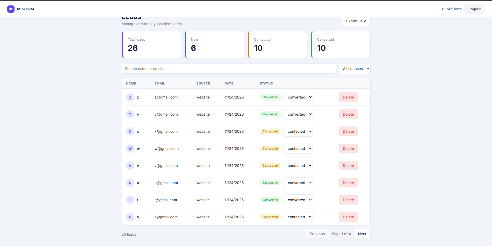

<div align="center">



# Mini CRM - Client Lead Management System

A full-stack web app to capture, track and manage client leads.
Built for the **Future Interns** Full Stack Web Development internship (Task 2).

[Live Demo](https://mini-crm-five-omega.vercel.app) · [Contact Form](https://mini-crm-five-omega.vercel.app/contact) · [API](https://mini-crm-api-iir5.onrender.com)

</div>

---

## Features

- **Public contact form** that saves new leads to the database
- **Admin login** with JWT authentication and protected routes
- **Dashboard** with live stats (total, new, contacted, converted)
- **Search** by name or email and **filter** by status
- **Update lead status**: new, contacted, converted
- **Lead details page** with notes history and editable contact info
- **Delete leads** with confirmation
- **Pagination** and **CSV export**
- **Toast notifications**, loading and error states, 404 page
- **Responsive design** for desktop and mobile
- **Security**: bcrypt password hashing, input validation, rate limiting, field whitelisting

## Tech Stack

| Layer    | Technologies                                         |
| -------- | ---------------------------------------------------- |
| Frontend | React, TypeScript, Vite, React Router, Axios         |
| Backend  | Node.js, Express 5, JWT, bcryptjs                    |
| Security | express-validator, express-rate-limit, CORS          |
| Database | MongoDB Atlas, Mongoose                              |
| Hosting  | Vercel (frontend), Render (backend)                  |

## Project Structure

```
FUTURE_FS_02/
├── backend/
│   └── src/
│       ├── config/        # database connection
│       ├── controllers/   # auth and lead logic
│       ├── middleware/    # auth, validation, rate limiter, error handler
│       ├── models/        # Admin and Lead schemas
│       ├── routes/        # API routes
│       ├── scripts/       # admin seed script
│       ├── app.js
│       └── server.js
├── frontend/
│   └── src/
│       ├── api/           # axios client
│       ├── components/    # Navbar, LeadTable, StatsCards, NotesPanel...
│       ├── context/       # Auth and Toast providers
│       ├── pages/         # Login, Dashboard, LeadDetail, PublicContact, 404
│       ├── types/         # TypeScript types
│       └── utils/         # CSV export, error helper
└── docs/                  # screenshots
```

## Getting Started

### Prerequisites

- Node.js 18 or newer
- A MongoDB Atlas cluster (free tier works)

### 1. Clone the repository

```bash
git clone https://github.com/codewithyusa/FUTURE_FS_02.git
cd FUTURE_FS_02
```

### 2. Backend

```bash
cd backend
npm install
cp .env.example .env    # then fill in your values
npm run seed            # creates the admin user
npm run dev             # starts the API
```

Backend `.env`:

```
PORT=8080
MONGO_URI=your_mongodb_connection_string
JWT_SECRET=a_long_random_string
CLIENT_URL=http://localhost:5173
ADMIN_EMAIL=admin@example.com
ADMIN_PASSWORD=choose_a_strong_password
```

### 3. Frontend

```bash
cd frontend
npm install
npm run dev
```

Frontend `.env`:

```
VITE_API_URL=http://localhost:8080/api
```

Open `http://localhost:5173` and sign in at `/login` with the admin email and password you set in the backend `.env`.

## API Endpoints

| Method | Endpoint               | Access | Description                          |
| ------ | ---------------------- | ------ | ------------------------------------ |
| POST   | `/api/auth/login`      | Public | Admin login, returns a JWT           |
| POST   | `/api/leads`           | Public | Submit a new lead (contact form)     |
| GET    | `/api/leads`           | Admin  | List leads, optional `?status=`      |
| GET    | `/api/leads/:id`       | Admin  | Get one lead with notes              |
| PATCH  | `/api/leads/:id`       | Admin  | Update name, email, phone or status  |
| POST   | `/api/leads/:id/notes` | Admin  | Add a note to a lead                 |
| DELETE | `/api/leads/:id`       | Admin  | Delete a lead                        |

Admin routes require the header `Authorization: Bearer <token>`.
Login is limited to 10 attempts per 15 minutes, and the public form to 20 submissions per hour per IP.

## Deployment

- **Backend**: Render web service, root directory `backend`, build `npm install`, start `npm start`
- **Frontend**: Vercel, root directory `frontend`, environment variable `VITE_API_URL`
- **Database**: MongoDB Atlas

> The backend runs on Render's free tier, so the first request after a period of inactivity can take about 50 seconds.

## Author

**Yusuf Umer**
GitHub: [@codewithyusa](https://github.com/codewithyusa)

## License

This project was built for educational purposes as part of the Future Interns internship program.